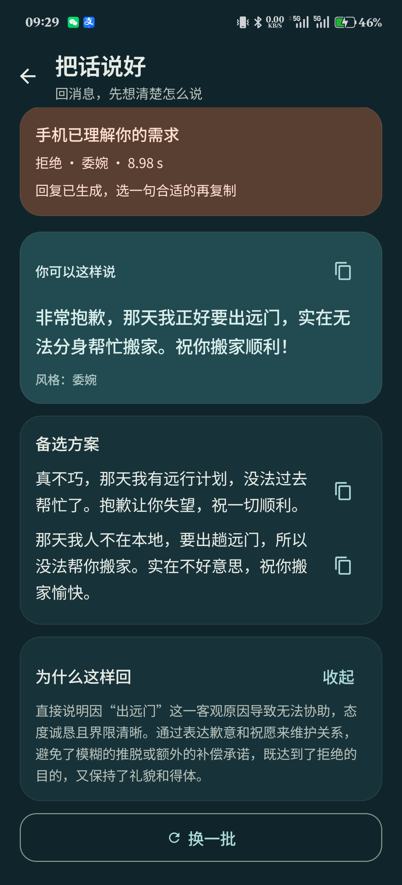
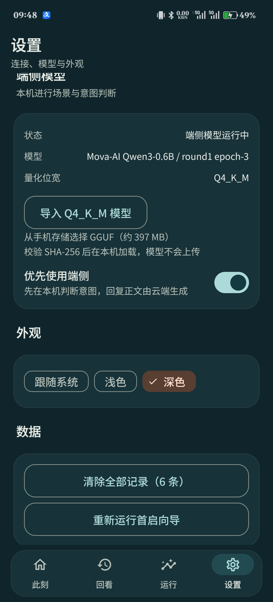

# Mova-AI / Mova·照应 · 端侧场景理解与生活助手

> 面向 Android 的端云协同 AI 原型：围绕结构化场景理解、教师数据构造、Qwen3-0.6B LoRA 微调与代价敏感路由，实现小模型在移动端的结构化决策与云端生成协作。

[](https://developer.android.com/)
[](https://kotlinlang.org/)
[](https://developer.android.com/jetpack/compose)
[](https://fastapi.tiangolo.com/)
[](https://www.python.org/)
[](#二系统架构)

产品以「离家之后，小事也有重量」聚焦沟通、阅读与做饭；竞赛定位、最小闭环和可直接使用的报名文案见 [竞赛叙事与产品方案](docs/14-竞赛叙事与产品方案.md)。Android 环境、实测与限制见 [端侧接入记录](docs/13-Android端侧接入.md)。

视觉采用珍珠白、深海青与暖珊瑚，首页接入原创背景图，四个功能页采用统一的场景装饰与任务步骤。「运行与技术」保留实际模型状态、延迟与本机试运行。设计说明、素材来源与实机截图见 [竞赛视觉升级](docs/16-竞赛视觉升级.md)。

「城市初见」支持出行换城通知与原地模拟。2026-10-29 接入首版城市知识库：武汉、岳阳、青岛共 12 块带政府网站来源的资料，采用城市过滤与 BM25 检索；「问问这座城」由云模型选择证据，答案附引用。未收录城市展示地图地点并标明资料缺口。OPPO 真机已验证旧卡片升级、资料展示、真实云端问答、来源跳转和模拟到达持久化；真实跨城与长期后台未验收。见 [知识库实现详解](docs/20-20261029_134746-城市知识库实现详解.md) 与 [城市提醒测试](docs/15-城市初见功能方案.md)。

---

## 一、问题定义与技术目标

Mova-AI 聚焦一个移动端工程问题：**如何把场景识别、意图判断和结构化信息抽取等高频轻任务交给小模型，同时为低置信度或高复杂度任务保留云端升级路径。**

当前项目包含 Android 客户端、FastAPI 在线服务和离线训练流水线。在线回复目前由云端模型生成；Qwen3-0.6B 已完成**两轮 LoRA 训练**（每轮 3 epoch）、500 条教师标签评测和 150 条 AI 复核话语压力测试。选定第一轮 epoch-3 后，已完成 LoRA 合并、F16 GGUF 转换、Q4_K_M 量化与服务器 CPU 单条推理；Android GGUF / JNI 已接入，OPPO 真机中文判断通过；聊天采用本地理解与云端正文生成。文档将“已实现能力”和“目标架构”分开描述。

| 技术问题 | 当前方案 | 当前状态 |
|---|---|---|
| 如何定义小模型的任务边界？ | 以可执行 JSON 契约描述 `scene`、`intent`、`need_cloud`、复杂度与槽位 | 契约与校验器已实现 |
| 如何构造足够覆盖任务边界的训练样本？ | 教师标注、契约校验、去重、分层抽样；SFT 前校验数据 ID、标签和数据摘要 | 试验流水线已跑通；服务器正式训练批次为 5500 条，评测集 500 条 |
| 如何训练并衡量小模型？ | Qwen3-0.6B + LoRA，输出层级的监督微调；用独立预测文件评测合法率、分类、路由和槽位指标 | 第一轮 5500 条、第二轮 5704 条；两轮评测完成，选用第一轮 epoch-3；人工标注测试待做 |
| 什么时候升级云端？ | 基于置信度、复杂度、结构校验与延迟代价的路由规则 | 端侧聊天预判断已接入；正文固定由云端生成，自报置信度未校准 |
| 如何得到可部署模型？ | 选定 LoRA → 合并权重 → F16 GGUF → Q4_K_M → CPU 冒烟推理 | 服务器流程与 Android 真机冒烟已完成；文件 396,704,544 字节（约 378.33 MiB / 397 MB） |

项目的工程重点是**数据质量、输出契约、可复现训练与可审计评测**。端侧模型学习的是场景/意图、复杂度、上云判断和槽位，**不是短信、菜谱或摘要正文生成器**。需要长文本时，App 应根据端侧决策调用现有云端生成接口并展示最终内容。GGUF 已在 OPPO Find X7 Ultra 完成中文场景判断；Logit/Feature 蒸馏没有实施。

---

## 二、系统架构

```text
当前可运行链路
Android UI ── Retrofit/JSON 契约 ──> FastAPI ── Provider ──> 云端模型
    ▲                                  │
    └──────── 结构化结果 + meta ────────┘

离线训练链路
教师标注数据 ──> 契约校验/筛选 ──> JSONL SFT ──> Qwen3-0.6B + LoRA
                                                  ├──> 500 条评测集 / 150 条压力测试
                                                  └──> 合并 HF → F16 GGUF → Q4_K_M

聊天主线（已接入；正文由云端生成）
Android 短文本 ──> 端侧小模型 ──> 契约校验/槽位提取 ──> 云端生成正文
                                    └── 失败/超时：云端回退
候选回复 ──> 用户确认复制 ──> 本机历史（附实际端侧与云端阶段耗时）
```

### 路由实现边界

`MovaRepository` 的短文本聊天回复先运行本机 GGUF，校验后抽取沟通目标并通过 Retrofit 请求云端正文。聊天页显示本机判断；技术面板记录 `edge_decision` 耗时。用户显式目标优先，端侧失败自动回退。`need_cloud` 尚不控制正文离线生成。

---

## 三、界面：为新用户设计，而不是为演示设计

**"友好"被拆成了 8 条可验收的标准**（详见 [`docs/03-UI-UX设计规范.md`](docs/03-UI-UX设计规范.md)）：

| # | 标准 | 做法 |
|---|---|---|
| 1 | 首启最多 3 步进主界面 | 价值说明 → 权限 → 连接配置，每步都可跳过 |
| 2 | 用户不需要想"输入什么" | 每个能力页都有**一键示例**（做饭内置示例图、阅读内置范文、聊天内置场景） |
| 3 | 空状态有明确下一步 | 插图 + 一句话 + 一个按钮 |
| 4 | 错误能自己解决 | 严格「发生了什么 / 为什么 / 怎么办」三件套 + 可点的出路 |
| 5 | 结果能拿走 | 所有结果卡都有复制按钮 |
| 6 | 权限有理由 | 授权前说清"用来做什么" |
| 7 | 长内容不被截断 | 全面废弃 Toast，改为结构化结果卡 |
| 8 | 高级能力不吓人 | 技术面板独立成一级入口，主流程零术语 |

### 实机界面展示

以下展示当前版本在 OPPO Find X7 Ultra 上运行的深色模式实机界面。

| 此刻 | 把话说好 | 读懂一页 |
|---|---|---|
|  |  |  |

| 好好吃饭 | 城市初见 | 运行与技术 |
|---|---|---|
|  |  |  |

| 沟通结果 | 模型与外观设置 |
|---|---|
|  |  |

截图来自真实 APK，端侧状态与调用记录由实际运行产生。截图中的耗时是单条示例结果，不代表跨设备性能基准。

素材来源、设计说明与实机核查记录见 [竞赛视觉升级](docs/16-竞赛视觉升级.md)。

### 从微信分享进来（聊天辅助的接入方式）

来源应用支持分享文字时，选择消息 → 分享 → Mova·照应。内容会填入当前「把话说好」页面，用户选择语气和目标并确认后再生成；具体分享菜单由来源应用决定。

聊天输入采用 Android 系统分享入口：用户在来源应用中主动选择内容，再分享给 Mova-AI。
另一种设计是通过 `AccessibilityService` 读取其它应用界面；它能减少手动操作，但需要更广泛的界面访问权限，也更依赖来源应用的 UI 结构。

| 维度 | 无障碍读屏 | 分享入口（本方案） |
|---|---|---|
| 用户操作 | 可减少手动分享 | 用户显式选择并分享内容 |
| 数据范围 | 可能接触来源应用的更多界面信息 | 仅接收系统分享的内容 |
| 维护成本 | 依赖来源应用 UI 结构 | 使用 Android 标准 Intent |

当前实现优先采用显式分享，以缩小数据范围并降低对第三方界面结构的耦合。界面会提示用户：内容由用户主动分享，App 不读取其它应用界面。

### 页面说明

| 页面 | 说明 |
|---|---|
| 首启向导 | 3 屏，含**连接检测**（失败时给出排查清单）与「演示模式」兜底 |
| 此刻 | 原创玻璃环抱光球背景 → 沟通主入口 → 沟通/阅读/做饭/城市四个场景入口 → 真实运行状态 |
| 做饭助手 | 拍照（**全分辨率**）/ 相册 / 试试示例 → 阶段化加载（识别→生成）→ 菜谱卡 |
| 阅读总结 | 文本 / 截图 / PDF 三 tab，**同一套输出契约**，结果卡只写一份 |
| 把话说好 | 语气与目标选择、本机判断、候选回复与解释、用户确认复制；支持分享预填与多轮上下文 |
| 回看 | 按场景筛选本机历史，每条带**端侧/云端徽标**，可点进详情 |
| 运行与技术 | 协作流程、实际请求统计与延迟拆解；模型详情、本机试运行可展开，保留最近请求与**路由原因** |
| 设置 | 服务连接、实验提醒偏好、模型导入、外观、数据、关于 |

> 技术面板是面向用户的可观测性界面：展示执行端、延迟拆解、端侧模型状态与路由原因。

---

## 四、技术栈

**Android 端（`SceneAi_App/`）**

| 项 | 选型 | 为什么 |
|---|---|---|
| 语言 | **Kotlin 2.1** | 协程 + 密封类，适合表达"加载/成功/失败/降级"状态机 |
| UI | **Jetpack Compose + Material 3** | 多页面 + 动态状态（阶段化加载、降级横幅）代码量远低于 XML |
| 导航 | Navigation Compose | 单 Activity，路由集中声明 |
| 状态 | ViewModel + StateFlow | 单向数据流，UI 只渲染 UiState |
| 网络 | Retrofit + OkHttp + kotlinx.serialization | 与后端契约一一对应，编译期强类型 |
| 本地存储 | DataStore(Preferences) + JSON 文件 | 设置用 DataStore；历史记录量小（≤200 条），用文件省掉 Room 的注解处理器 |
| 依赖注入 | 手写 `AppContainer` | 依赖图只有 4 个对象，比引入 Hilt 更透明、编译更快 |
| 构建 | Gradle 8.13 + AGP 8.13.1 + Version Catalog | 版本集中管理 |

**云侧（`scene_ai_server/`）**

| 项 | 选型 | 为什么 |
|---|---|---|
| 框架 | FastAPI + Pydantic | 契约即代码，自动生成 OpenAPI |
| 模型调用 | **只实现一次 OpenAI 兼容协议** | DashScope 兼容模式 / DeepSeek / 自建 vLLM 都说这套协议，一个类覆盖三家 |
| 容错 | 指数退避重试 + JSON 多层兜底提取 | 小模型不按格式返回是常态，在解析层尽量救回来 |
| 上传校验 | **魔数嗅探**而非信任 Content-Type | 堵住"上传接口无校验"这个经典问题 |
| 可观测 | 业务响应带 `meta`（执行方式/模型/耗时/阶段拆解/路由原因） | 与 App 本机 `edge_decision` 阶段合并展示 |

---

## 五、快速开始

### 第 1 步：启动云端服务

```bash
cd scene_ai_server
pip install -r requirements.txt
```

配置 API Key（**源码中不含任何密钥**）。复制模板后填入：

```powershell
Copy-Item .env.example .env      # PowerShell
# cp .env.example .env           # Bash
```

编辑 `.env`，商业接口填入自己的 Key：

```ini
MOVA_PROVIDER=dashscope
DASHSCOPE_API_KEY=sk-你的Key
# 也可以切成 DeepSeek：
# MOVA_PROVIDER=deepseek
# DEEPSEEK_API_KEY=sk-你的Key
# 自建 vLLM 服务可选（无鉴权部署时允许空 Key，地址与模型名按实际填写）：
# MOVA_PROVIDER=vllm
# MOVA_BASE_URL=http://xxx:xxx/v1
# MOVA_API_KEY=
# MOVA_LLM_MODEL=你的模型名
# MOVA_VISION_MODEL=支持视觉的模型名
```

也可以不用 `.env`，直接设置环境变量（`DASHSCOPE_API_KEY` / `DEEPSEEK_API_KEY` / `MOVA_API_KEY`）。

启动（这里使用 8000；改端口时同步修改 App 服务地址）：

```bash
uvicorn app:app --host 0.0.0.0 --port 8000 --reload
```

- 交互式文档：**http://localhost:8000/docs**
- 健康检查：**http://localhost:8000/health**（首启向导的「检测连接」就是打这个）

### 第 2 步：编译运行 Android 端

1. 用 **Android Studio** 打开 `SceneAi_App/` 目录（**不是仓库根目录**）
2. 确认 **JDK 17+**，并在 SDK Manager 安装 Android SDK、NDK 与 CMake；端侧 JNI 构建还需要 `SceneAi_App/third_party/llama.cpp-retry/` 下的上游源码
3. 连接真机或模拟器，点击 Run

命令行构建：

```powershell
cd SceneAi_App
$env:JAVA_HOME = "你的 JDK 路径"
.\gradlew.bat :app:assembleDebug
```

产物：`app/build/outputs/apk/debug/app-debug.apk`

当前端侧 Q4_K_M GGUF 通过 App「设置 → 端侧模型」从手机存储导入，APK 不包含 397 MB 权重。模型只负责场景、意图与槽位判断；聊天回复正文由云端生成。接入步骤、校验值与验收方法见 [Android 端侧接入](docs/13-Android端侧接入.md)。这轮 JNI 已通过 Android 编译与 OPPO 前台中文真机冒烟。

### 第 3 步：配置联调地址

App 内可以随时改：**设置 → 服务连接**，或**首启向导第 3 屏**点「检测连接」。

| 调试方式 | 地址 |
|---|---|
| 模拟器 | `http://10.0.2.2:8000/`（10.0.2.2 是模拟器访问宿主机 localhost 的固定别名） |
| 真机 · 局域网 | `http://电脑的局域网IP:8000/`（`ipconfig` 查询，手机与电脑须同一网段） |
| 真机 · USB | `adb reverse tcp:8000 tcp:8000` 后填写 `http://127.0.0.1:8000/`；拔线后此映射不可用 |

服务以 `--host 0.0.0.0` 启动，真机可直接通过局域网 IP 访问。

### 第 4 步（可选）：跑一遍数据引擎

数据构造不需要 GPU，但需要可访问的教师模型服务和对应 API 配置。下面命令是仓库内的小规模流水线试跑：

```bash
cd scene_ai_server
python smoke_test.py --vision          # 测试当前 Provider 的文本/视觉调用（视觉模型可选）
python pipeline/build_dataset.py --limit 150 --budget 60
python pipeline/evaluate.py --predictor teacher-b
```

这会生成早期 pilot 规模的数据集，不会复现服务器上的 5500/500 正式训练批次。产物落在 `scene_ai_server/data/`；教师调用有缓存，重复运行可复用已缓存的标注。

### 第 5 步：运行 Qwen3-0.6B LoRA SFT

训练需要支持 CUDA 的 PyTorch、Transformers、PEFT，以及本地 Qwen3-0.6B 底座权重。服务器已验证组合为 PyTorch `2.10.0+cu128`、Transformers `5.12.1`、PEFT `0.21.1`、Accelerate `1.15.0`；先按机器 CUDA 环境安装 PyTorch，再安装本轮专用 `requirements-lora.txt`。`requirements-train.txt` 是较宽的可选离线实验依赖清单，不等于本轮训练环境锁文件，避免在已验证环境中直接全量安装。正式训练数据保存在训练服务器上，不随 GitHub 仓库发布；`build_sft.py` 会校验正式数据批次的 MD5，仓库内 60 条 pilot 数据不能通过该正式批次校验。

```bash
cd scene_ai_server
# 先准备与本机 CUDA 匹配的 PyTorch，再安装本轮验证过的包组合
python -m pip install -r requirements-lora.txt
# 显式使用正式批次；仓库内同名文件只有 60 条 pilot，不要覆盖它
TRAIN=/path/to/formal/distill_dataset.jsonl
test "$(wc -l < "$TRAIN")" -eq 5500
md5sum "$TRAIN"  # 应为 d32b73adbc456212f42eaae2099d93ee
python build_sft.py --input "$TRAIN" --output data/model_output/sft_train.jsonl
wc -l data/model_output/sft_train.jsonl  # 应为 5500 条
python train_lora.py \
  --base-model /path/to/Qwen3-0.6B \
  --train-file data/model_output/sft_train.jsonl \
  --output-dir data/model_output/qwen3-0.6b-lora
```

训练脚本默认 3 个 epoch、LoRA rank 16、BF16、最大序列长度 2048，并在每个 epoch 保存 adapter。全量模型评估需先用 `predict_lora.py` 生成预测，再通过 `pipeline/evaluate.py --predictor file` 计算指标。具体 CUDA/PyTorch 安装方式取决于训练机驱动与 CUDA 运行时。
不传 `--adapter` 时，`predict_lora.py` 会直接评估未微调底座，供三个 LoRA checkpoint 对照；正式评测请使用服务器上的 500 条 gold。

**评测数据版本检查：**仓库跟踪的 `data/eval_gold.jsonl` 只有 40 条 pilot 样本，不能用于正式的 500 条结果复算。运行正式评测时，先将 `GOLD` 指向下载的正式文件，并核对行数与 MD5；本次训练的正式文件 MD5 是 `27a33ffbf5d2dd01d391533cb0443f3c`。

```bash
GOLD=/path/to/formal/eval_gold.jsonl
test "$(wc -l < "$GOLD")" -eq 500
md5sum "$GOLD"  # 应为 27a33ffbf5d2dd01d391533cb0443f3c

python predict_lora.py \
  --base-model /path/to/Qwen3-0.6B \
  --adapter data/model_output/qwen3-0.6b-lora/epoch-1 \
  --gold "$GOLD" \
  --output data/model_output/qwen3-0.6b-lora/epoch-1/predictions.jsonl
python pipeline/evaluate.py \
  --gold "$GOLD" \
  --predictor file \
  --predictions data/model_output/qwen3-0.6b-lora/epoch-1/predictions.jsonl \
  --out data/model_output/qwen3-0.6b-lora/epoch-1/eval_report.md
```

### 第 6 步：导出选定模型并做 GGUF 冒烟推理

两轮训练的对比结果见[第二轮回归审计](docs/10-第二轮训练回归审计.md)。原型选用**第一轮 epoch-3**，合并 LoRA、转换 F16 GGUF、量化为 Q4_K_M、以训练同款 Qwen3 非思考模板做单条 CPU 推理的完整命令见[端侧模型导出记录](docs/11-端侧模型合并与GGUF转换.md)。`prepare_gguf_prompt.py` 负责构造不含 gold 标签的推理输入。Android JNI、模型导入、前台中文冒烟与云端生成闭环也已完成，见[Android 端侧接入](docs/13-Android端侧接入.md)。

---

## 六、接口文档

基地址 `http://<host>:8000`。业务分析接口在响应中附带 `meta`，用于记录模型、耗时、执行方式与路由原因；`/health` 和 `/capabilities` 返回服务状态与能力清单，不包含该字段：

```json
{
  "meta": {
    "executor": "cloud",
    "model": "<configured-model>",
    "latency_ms": 1240,
    "route_reason": "本接口由云端生成；客户端端侧判断见本机阶段记录",
    "stages": { "recognize": 420, "generate": 820 },
    "confidence": null
  }
}
```

| 接口 | 入参 | 返回要点 |
|---|---|---|
| `GET /health` | — | `status`、`version`、`provider`、`models`、`edge` |
| `GET /capabilities` | — | 场景清单（驱动客户端首页能力网格） |
| `POST /analyze_image` | multipart `file` | `ingredients` / `dish` / `steps` / `tips` + `meta.stages` 两段耗时 |
| `POST /reading/text` | JSON `{content}` | `summary` / `key_points` / `difficulty` / `qa_suggestion` |
| `POST /reading/image` | multipart `file` | 同上 |
| `POST /reading/pdf` | multipart `file` | 同上 + `page_count` |
| `POST /chat/reply` | JSON `{context, style, goal?}` | `reply` / `alternatives[]` / `explain` |
| `POST /chat/rewrite` | JSON `{text, style}` | 同上 |
| `POST /chat/context` | JSON `{messages[], goal, style}` | 同上 |
| `POST /city/resolve` | JSON `{longitude, latitude, coordsys}` | 高德解析的城市编码、城市名；`coordsys` 为 `wgs84` / `gcj02` |
| `GET /city/guide` | query `city_code`、`city_name` | v4 有来源城市资料；未收录城市回退地图地点，地图结果缓存 24 小时 |
| `POST /city/ask` | JSON `{city_code, question}` | 本城 BM25 检索、云模型选择证据 ID、引用校验及资料不足处理 |

**返回示例**（`/chat/reply`）：

```json
{
  "scene": "chat",
  "reply": "实在抱歉，那天我正好要出远门，没法过去帮忙。祝你搬家顺利！",
  "style": "委婉",
  "alternatives": ["不好意思，那天我要出远门，时间冲突了，祝搬家顺利。", "真不巧，那天我无法分身去帮忙，抱歉了。"],
  "explain": "说明用户给定的客观原因，明确而礼貌地拒绝，不新增承诺",
  "meta": { "executor": "cloud", "model": "<configured-model>", "latency_ms": 1875, "route_reason": "本接口由云端生成；客户端端侧判断见本机阶段记录", "stages": {} }
}
```

---

## 七、数据构造与训练数据

数据链路分为两种规模：仓库提交的是用于验证数据引擎的 pilot 样本；当前正式 LoRA 训练批次在服务器侧生成和校验，避免把完整训练数据直接提交到公开仓库。

### 正式训练批次（服务器侧）

| 数据 | 数量 | 用途 |
|---|---:|---|
| `data/distill_dataset.jsonl` | 5500 | 教师标注的结构化场景理解 SFT 样本 |
| `data/eval_gold.jsonl` | 500 | 分层评测；以教师标签为主，并对个别样本做人工修正 |
| `data/sft_train_*.jsonl` | 5500 | `build_sft.py` 从正式数据转换得到的 user/assistant 对话 |

正式训练集 MD5 为 `d32b73adbc456212f42eaae2099d93ee`，由 `build_sft.py` 默认校验。SFT 监督只作用于 assistant 侧的结构化 target；当前这轮是 **Qwen3-0.6B 的 LoRA SFT**，不是 Logit 或 Feature 蒸馏。评测集标签仍以教师标注为主，因此学生在该集合上的分数不能等同于人工标注基准上的绝对准确率。

正式训练批次的场景构成：

| 教师标签场景 | 样本数 | 占比 |
|---|---:|---:|
| food | 2148 | 39.1% |
| reading | 1566 | 28.5% |
| none | 646 | 11.7% |
| location | 597 | 10.9% |
| chat | 543 | 9.9% |

### LoRA 训练实测

| 指标 | 结果 |
|---|---:|
| 50 条冒烟测试 | 1 epoch 完成；平均 loss 1.2224；PyTorch 峰值已分配显存 17.85 GiB |
| 可训练参数 | 10,092,544 / 606,142,464（1.6650%） |
| 正式训练 | 5500 条、3 epoch、516 个优化 step；`python exit=0` |
| 第 3 轮平均训练 loss | 0.0529 |
| 正式训练 PyTorch 峰值已分配显存 | 18.15 GiB |
| epoch-1 预测冒烟 | 25 条预测已生成，输出文件 25 行；本次另对完整 500 条进行了正式评测 |

这些是训练和预测终端日志中的数据，显存列为 PyTorch 统计值，并非整卡占用。完整故障、评测结果与边界见[阶段二训练记录](docs/06-阶段二训练记录.md)。

### 500 条教师标签评测

四组预测各 500 条，ID 与同一份 gold 对齐；本地复算与服务器报告一致。

| 模型 | 契约合法率 | scene | intent | need_cloud | 槽位 F1 |
|---|---:|---:|---:|---:|---:|
| 未微调底座 | 86.8% | 37.3% | 27.9% | 49.5% | 37.4% |
| epoch-1 | 100% | 99.8% | 96.6% | 89.8% | 95.0% |
| epoch-2 | 100% | 99.0% | 97.4% | 93.2% | 95.7% |
| epoch-3 | 100% | 99.6% | 97.0% | 93.2% | 96.3% |

准确率以契约合法输出为分母，因此底座的准确率仅覆盖 434 条合法预测。第一轮 epoch-3 的上云判断错 34/500 条，`confidence` 尚未校准。第二轮 epoch-2 在同一 500 条教师 gold 上 scene 为 99.8%、intent 为 95.6%、need_cloud 为 92.8%、槽位 F1 为 96.26%；它改善部分定向压力题，却在阅读意图和上云判断上回退，因此原型继续选用第一轮 epoch-3。详见[第二轮回归审计](docs/10-第二轮训练回归审计.md)。这些分数不能替代真实用户的独立人工测试。

### 150 条新话语压力测试

新测试集由 AI 起草和复核，已在服务器对正式 5500/500 数据做查重并锁定；它用于定向排查，**不是人工标注金标准**。epoch-3 在这份测试上契约合法率 150/150、scene 145/150、intent 139/150、上云判断 33/50、已标注槽位 64/83；10 个问题族仅 4 个达到预设门槛。所有 15 条需要查询附近场所当前营业/开放信息的请求均被判为不上云，17 条具体位置类型被错判为“其他”。详见[独立定向测试结果](docs/08-独立定向测试结果.md)。

### 数据引擎 pilot（仓库内报告）

仓库内 `dataset_report.md` 和 `eval_report.md` 记录的是早期试跑：150 条种子候选，经筛选得到 60 条训练样本和 40 条评测样本。下面的覆盖率与教师一致率指标只描述这轮 pilot，不代表服务器上的 5500/500 正式批次。

当前 `pipeline/seeds.py`、`build_dataset.py`、`contract.py` 和 `teacher.py` 已对齐正式数据生成时使用的版本：种子池按场景再平衡，gold 按教师标签的场景与意图分层抽取，并支持增量缓存与按环境开关跳过不适用的教师采样。仓库跟踪的 60/40 pilot 产物仍是早期快照，运行当前代码不会复现它们的原始文件摘要。

```bash
cd scene_ai_server
python pipeline/build_dataset.py --limit 150 --budget 60
```

```
① 种子展开 (150)  →  ② 双教师标注  →  ③ 契约校验  →  ④ 三信号难度
                                    →  ⑤ MinHash 去重  →  ⑥ 子模覆盖  →  ⑦ 配额配比
```

### 实测结果（全部来自真实运行，未手工填写）

| 阶段 | 指标 | 结果 |
|---|---|---|
| ③ 契约校验 | **契约合法率** | **100%**（150/150） |
| ④ 难度评估 | 平均难度 / 三信号可用数 | 0.312 / 150·150·143（教师置信度暂代学生探针损失） |
| ⑤ 去重 | LSH 候选对 → 精确复核删除 | 274 → **22 条（14.7%）** |
| ⑥ 覆盖优化 | 网格覆盖 | **37/37 格** |
| ⑥ 覆盖优化 | 子模目标 F vs 随机基线 | 47.01 vs 39.71 → **提升 18.4%** |
| ⑦ 配额配比 | 难度分布 vs 目标 (30/50/20) | **36.7% / 50.0% / 13.3%** |
| 40 条 pilot 评测 | 教师 B 对教师 A 标签的一致率 | scene 87.2% / intent 82.0% / 槽位 F1 0.838 |

### Pilot 阶段的三个问题与修正

1. **契约枚举用了英文、prompt 又没列取值 → 合法率 0%。** 教师只能猜，输出「晚饭」而不是 `dinner`。修正后 100%。教训：*契约必须显式到模型能照抄的程度。*
2. **`temperature=0` 会摧毁 logprobs。** 极低温度把分布压成 one-hot，接口返回的 `logprob` 恒为 0、候选恒为 -9999。因此标签（T=0，保证可复现）与软标签（T=1，保证分布有意义）**必须分成两次调用**。
3. **难度分布稀疏是语料问题，不是度量问题。** 第一轮 120 条全落进 easy 档；排查后发现种子都是"换个食材名"式的表面变化，任务本身毫无歧义。补上真正的困难样本、并把采样从「全局随机截断」改成「按组轮转」后，hard 档才被填满。

> 第 3 条对任何数据流水线都成立：**稀有类别必须显式保底，不能指望随机采样照顾它。**

### Pilot 产物（随仓库提交）

| 文件 | 内容 |
|---|---|
| `data/distill_dataset.jsonl` | 蒸馏数据集：硬标签 + **软标签（教师 top-K 分布）** + 难度 + 质量分 |
| `data/eval_gold.jsonl` | 评测集 v1（与训练集按 id 严格互斥） |
| `data/edge_contract.schema.json` | 端侧语法约束解码用的 JSON Schema |
| `data/dataset_report.md` | 自动生成的统计报告 |
| `data/eval_report.md` | 评测报告（标签噪声下限） |

在这 40 条 pilot 评测中，`none`（无场景/歧义输入）的教师间一致率较低（42.9%）。这是标注分歧的观察结果，不是对“难度信号有效性”的因果证明；后续需在正式评测集上重新验证。

人工抽检、教师端点诊断和分层子集抽取工具见 [`tools/README.md`](tools/README.md)。其中抽检与子集抽取均按教师标签分层；正式批次需显式指定对应的数据文件。

---

## 新增：行动卡、偏好与离线应急卡

阅读页可从通知文字或截图提取附原文片段的待办，并由用户确认后打开日历保存；设置页可主动保存回复偏好和忌口；沟通页增加由本机 0.6B 判断目标、固定模板出句子的断网应急卡。截图识别与行动抽取仍调用云端；离线应急卡不生成长文本。详细入口、边界与部署见 [功能说明](docs/17-行动卡偏好与离线应急卡.md)。

## 八、端侧模型路线图

详细方案见 [`docs/02-端侧模型方案.md`](docs/02-端侧模型方案.md)，这里只给结论：

| 环节 | 方案要点 |
|---|---|
| **能力契约** | 端侧候选任务为场景/意图识别、复杂度估计、路由建议与槽位抽取；长生成和复杂任务保留云端路径 |
| **当前训练** | Qwen3-0.6B + LoRA；第一轮 5500 条、第二轮 5704 条，每轮 3 epoch；选定第一轮 epoch-3 |
| **评估边界** | 500 条教师 gold 与 150 条 AI 复核压力题已完成；有上云误判和标签边界，尚未建立独立人工金标准 |
| **蒸馏扩展** | 当前未实现 Logit/Feature 蒸馏；后续可评估 top-K logits 缓存和中间层表征蒸馏的收益与成本 |
| **量化与运行时** | 已完成合并 HF → F16 GGUF → Q4_K_M（396,704,544 字节，约 397 MB / 378.33 MiB）；Android JNI 与 OPPO 中文单条冒烟通过 |
| **路由校准** | 聊天已消费本地决策与槽位，但正文始终由云端生成；置信度校准、升级阈值的实测优化尚未实施 |

> **当前边界**：Android 已加载模型并完成本机识别 → 云端回复 → 确认复制 → 本机历史。`need_cloud` 不是离线正文生成开关，置信度未校准；手机数据仅为单条实测，未完成全量量化后评测和跨机型性能测试。

---

## 九、目录结构

```
Mova-AI/
├── docs/                                   # 📘 设计文档
│   ├── 01-总体设计.md                       #    问题定义、级联路由框架、创新点、实验设计、路线图
│   ├── 02-端侧模型方案.md                    #    能力契约、数据引擎、三层蒸馏、量化、运行时、路由
│   └── 03-UI-UX设计规范.md                   #    信息架构、页面规格、设计 token、文案规范
│
├── scene_ai_server/                        # 🐍 云侧服务 + 离线流水线
│   ├── app.py                              #    路由层（唯一处理 HTTP 的地方）
│   ├── jsonx.py                            #    零依赖 JSON 兜底提取（在线与离线共用）
│   ├── mova/
│   │   ├── config.py                       #    配置（唯一读环境变量的地方）
│   │   ├── providers.py                    #    厂商适配（唯一发请求的地方）
│   │   └── prompts.py                      #    提示词（唯一写 prompt 的地方）
│   ├── pipeline/                           #    🔬 教师调用、数据筛选、契约校验与评测
│   │   ├── contract.py                     #      S1 能力契约 + JSON Schema + 校验器
│   │   ├── seeds.py                        #      场景种子库（按组轮转采样）
│   │   ├── teacher.py                      #      双教师客户端（含 logprobs 捕获）
│   │   ├── difficulty.py                   #      三信号难度
│   │   ├── dedup.py                        #      MinHash + LSH
│   │   ├── coverage.py                     #      子模最大化覆盖
│   │   ├── allocate.py                     #      配额配比（最大余数法）
│   │   ├── build_dataset.py                #      主流程 + 报告生成
│   │   └── evaluate.py                     #      评测（含标签噪声下限）
│   ├── data/                               #    产物：数据集 / 评测集 / 报告（cache 已忽略）
│   ├── build_sft.py                         #    将教师标注转换为 chat-format SFT JSONL
│   ├── train_lora.py                        #    Qwen3-0.6B LoRA SFT 训练
│   ├── predict_lora.py                      #    加载底座与 adapter 生成评测预测
│   ├── merge_lora.py                        #    将选定 adapter 安全合并进底座
│   ├── prepare_gguf_prompt.py               #    构造与训练一致的 GGUF 冒烟提示
│   ├── requirements.txt · requirements-lora.txt · requirements-train.txt
│   └── .env.example
│
├── SceneAi_App/                            # 📱 Android 端（Kotlin + Compose，单 Activity）
│   ├── app/src/main/java/com/mova/sceneai/
│   │   ├── MainActivity.kt · MovaApp.kt
│   │   ├── core/                           #    容器 / 设置 / 错误 / 媒体 / 格式化
│   │   ├── data/                           #    model / remote / local / repo（含 Router）
│   │   └── ui/                             #    theme / nav / components / 各页面
│   ├── keystore/debug.keystore             #    一次性调试密钥（口令为约定的 android）
│   └── gradle/libs.versions.toml
│
└── README.md
```

---

## 十、实现进度

图例：✅ 已验证　🟡 进行中　⬜ 未开始或仅有设计

| 层 | 模块 | 状态 |
|---|---|---|
| 端·交互 | Compose 多页面应用 | ✅ **编译通过，产出 APK** |
| 端·交互 | 首启向导（价值 → 权限 → 连接检测） | ✅ |
| 端·交互 | 结构化结果渲染（全面取代 Toast） | ✅ |
| 端·交互 | 一键示例（三个场景各一份，冷启动友好） | ✅ |
| 端·交互 | 聊天辅助接收系统分享（`ACTION_SEND`，微信长按消息即可） | ✅ **已在模拟器验证** |
| 端·交互 | 「为什么现在完成」技术面板 + 端云徽标 | ✅ |
| 端·网络 | Retrofit + 统一错误翻译（三件套文案） | ✅ |
| 端·路由 | `Router` 代价敏感决策函数（端侧未就绪时恒走云端） | ✅ 代码就绪 |
| 端·推理 | 端侧 SLM 执行器（llama.cpp JNI） | ✅ arm64 / x86_64 编译通过；OPPO ARM 真机中文冒烟通过 |
| 端·推理 | 视觉轻量分类器 | ⬜ |
| 端·路由 | 置信度校准 + 语法约束解码 + 槽位校验 | ⬜ |
| 端·感知 | 城市初见（用户启动的出行定位 / 模拟行程） | ✅ 模拟坐标、高德解析、城市确认、系统通知、城市卡片真机闭环；真实跨城待测 |
| 端·感知 | 自动上下文触发（老虎机 + 退避）、悬浮窗 | ⬜ |
| 端·感知 | ~~无障碍读屏~~ → **主动放弃**，改用系统分享入口（合规性见上文） | 🚫 不采用 |
| 云·在线 | 7 个能力接口 + `/health` + `/capabilities` + `meta` | ✅ |
| 云·在线 | Provider 抽象（DashScope ⇄ DeepSeek ⇄ 自建） | ✅ |
| 云·在线 | 魔数校验、体积上限、重试退避、结构化日志、CORS | ✅ |
| 云·离线 | **S1 能力契约**（可执行契约 + JSON Schema + 校验器） | ✅ |
| 云·离线 | **数据引擎 pilot**（教师标注 → 难度/质量信号 → MinHash 去重 → 覆盖选择 → 配额补齐） | ✅ 150 条种子试跑 |
| 云·离线 | 正式 SFT 数据准备（5500 train / 500 eval） | ✅ 服务器侧校验完成 |
| 云·离线 | Qwen3-0.6B LoRA response-level SFT | ✅ 第一轮 5500 条、第二轮 5704 条，各 3 epoch；第一轮 epoch-3 用于导出 |
| 云·离线 | 预测生成与契约评测脚本 | ✅ 底座及第一轮 3 个 adapter 各 500 条预测、第二轮 epoch-2 500 条预测，以及两轮定向回归均已复算 |
| 云·离线 | 独立定向测试（150 条新话语探针、复核来源与查重工具） | ✅ AI 复核、正式数据查重、gold 锁定与两轮回归完成；不能冒充人工金标准 |
| 云·离线 | Logit / Feature 蒸馏 | ⬜ 当前训练未使用软标签或中间层特征 |
| 云·离线 | LoRA 合并、GGUF 转换、Q4_K_M 量化 | ✅ 约 1.2 GB F16 → 约 397 MB（378.33 MiB）Q4_K_M；服务器与手机中文推理通过 |
| 端·推理 | Android 加载 GGUF 并联通云端生成 | ✅ 本地识别、云端具体回复、复制和历史回看闭环通过 |
| 端·交互 | Mova·照应视觉与竞赛方案 | ✅ 首页、各能力页、导航、图标、引导与关于已更新；浅色与深色实机检查 |
| 工程 | 仪器测试 | ✅ 单条前台中文 GGUF 冒烟；核心业务自动化覆盖仍有限 |

---

## 十一、已知限制

- **当前端云协作范围**：短文本聊天消费本机 GGUF 判断与槽位，具体回复仍由 FastAPI 云端生成；其余视觉、阅读、改写和多轮功能走云端。尚未实现自适应的离线正文生成
- **仓库 pilot 与正式训练数据不同**：仓库跟踪 60 条训练样本和 40 条评测样本；服务器正式批次为 5500/500，正式数据未提交到 GitHub。公开报告中的 pilot 指标不能替代正式批次评估
- **评测标签仍不等于人工基准**：500 条正式评测样本以教师标注为主，仅个别样本人工修正；需要增加独立人工复核后，才能报告更强的绝对准确率结论
- **路由置信度未校准**：epoch-3 在教师标签集上有 34/500 条 `need_cloud` 误判；新话语测试中 150 条预测的 `confidence` 全为 0.95，包括全部 40 条全字段错误样本。不能把原始置信度直接当成可靠的放行阈值
- **当前只做 response-level SFT**：训练脚本仅对 assistant target 计算交叉熵；没有进行 Logit/Feature 蒸馏。后处理采用标准 Q4_K_M 量化，未执行分层敏感性或自定义混合比特优化
- **量化验证范围**：Q4_K_M 已在服务器 CPU 和 OPPO 真机产生合法 JSON；完成单条手机闭环（约 10.9 秒，含端侧约 8.8 秒、服务端约 2.0 秒）。这不是跨设备平均延迟；量化后全量质量、手机峰值内存与耗电未测量
- **回复正文由云端生成**：单独运行 GGUF 只会得到决策 JSON；App 用其辅助理解后调用 `/chat/reply`，断网不能生成完整回复
- **聊天辅助通过系统分享接入**：不实现后台读取其它应用界面；这是出于数据范围和 UI 耦合考虑所作的产品选择
- **主动感知范围**：城市初见需用户启动一次出行，支持 App 内模拟点位；真实跨城、长期后台与耗电未测。悬浮窗和上下文老虎机触发仍为设计稿
  （`Router.kt` 保留代价敏感规则；当前聊天采用本地预判断和云端正文生成）
- **服务端无鉴权**：任何能访问到端口的人都能消耗你的模型额度，**切勿直接暴露到公网**
- **明文 HTTP**：`network_security_config.xml` 为本地联调放开了明文流量，上线前需收紧
- **自动化测试覆盖不足**：已提供前台中文真机模型冒烟；视觉上传、系统分享与完整业务链路仍需扩充自动化覆盖
- **release 未开混淆**：开启前需为 kotlinx.serialization / Retrofit 补 keep 规则

---

## 十二、开发环境注意事项

| 事项 | 说明 |
|---|---|
| **仓库路径** | 仓库目录名为 `Mova-AI`。Gradle 配置保留了 `android.overridePathCheck=true`，用于兼容含非 ASCII 字符的上级目录；建议仍优先使用英文路径 |
| **调试密钥** | AGP 默认在 `~/.android/` 自动生成调试密钥，在受限环境（沙箱 / 无家目录写权限的 CI）会失败。这里改为使用仓库内置的 `SceneAi_App/keystore/debug.keystore`，其口令就是 Android 约定的 `android`，**不具备任何保密性**，仅供本地安装调试；release 请另行配置签名 |
| **Gradle 发行版** | `gradle-wrapper.properties` 默认使用阿里云镜像（文件里注释了官方地址与腾讯镜像）。之所以默认镜像：在部分网络环境下 JVM 直连 `services.gradle.org` 会在 TLS 握手阶段收到 Connection reset，而镜像站稳定可用 |
| **模型密钥** | 只放在服务端 `.env` 或环境变量里，**App 端永远不内置任何 Key** |
| **PDF 解析** | 默认只解析前 3 页（`MOVA_MAX_PDF_PAGES`），扫描件因无可提取文字会返回 422 并提示改用截图识别 |
| **数据与训练依赖** | 教师调用需要服务端 Provider 依赖和 API 配置；本轮 LoRA 训练先装 CUDA 匹配的 PyTorch，再用 `requirements-lora.txt`；`requirements-train.txt` 是扩展实验清单 |

---

## 十三、文档索引

| 文档 | 内容 |
|---|---|
| [`docs/01-总体设计.md`](docs/01-总体设计.md) | 问题定义、代价敏感级联路由框架、系统架构、技术选型、5 个创新点、**消融实验设计**、9 阶段路线图、风险预案 |
| [`docs/02-端侧模型方案.md`](docs/02-端侧模型方案.md) | 能力契约、数据引擎（三信号难度 / 子模覆盖 / LP 配比）、三层蒸馏、量化（分层敏感性 + 背包比特分配）、端侧运行时、端云路由、测量协议 |
| [`docs/03-UI-UX设计规范.md`](docs/03-UI-UX设计规范.md) | 新用户友好 8 条验收标准、信息架构、页面规格、设计 token、文案规范 |
| [`docs/04-能力契约.md`](docs/04-能力契约.md) | **S1**：端侧要学什么、为什么让模型自己输出 `need_cloud`、契约为什么必须可执行、两个实测缺陷的记录 |
| [`docs/05-数据引擎.md`](docs/05-数据引擎.md) | **S2**：三信号难度、MinHash+LSH、子模覆盖的数学依据、配额最优性说明、**三个实测发现** |
| [`docs/06-阶段二训练记录.md`](docs/06-阶段二训练记录.md) | **阶段二实战**：共享 GPU 配置、模型上传/环境/tokenizer 故障、修复步骤、训练与四组正式评测结果 |
| [`docs/07-独立测试操作.md`](docs/07-独立测试操作.md) | 150 条 AI 复核定向探针、正式 5500/500 查重、epoch-2/3 评测操作 |
| [`docs/08-独立定向测试结果.md`](docs/08-独立定向测试结果.md) | 首轮新话语压力测试结果、位置与上云判断错误分析、下一轮修复方向 |
| [`docs/09-第二轮定向补数与训练.md`](docs/09-第二轮定向补数与训练.md) | 第二轮新增 204 条数据、5704 条混合训练源及复现命令 |
| [`docs/10-第二轮训练回归审计.md`](docs/10-第二轮训练回归审计.md) | 第二轮 150 条回归和 500 条正式 gold 对比、第一轮 epoch-3 选模依据 |
| [`docs/11-端侧模型合并与GGUF转换.md`](docs/11-端侧模型合并与GGUF转换.md) | LoRA 合并、F16 GGUF、Q4_K_M 量化与服务器 CPU 推理命令和结果 |
| [`docs/12-端云接入与模型发布计划.md`](docs/12-端云接入与模型发布计划.md) | 端侧 JSON 与云端回复正文的职责边界、Android 接入闭环和公开产物范围 |
| [`docs/13-Android端侧接入.md`](docs/13-Android端侧接入.md) | JNI / llama.cpp、手机 GGUF 导入与实际沟通链路 |
| [`docs/14-竞赛叙事与产品方案.md`](docs/14-竞赛叙事与产品方案.md) | 产品故事、最小闭环、报名文案与演示脚本 |
| [`docs/15-城市初见功能方案.md`](docs/15-城市初见功能方案.md) | 模拟点位、城市提醒、自动推荐与功能验证 |
| [`docs/18-20261028_180121-新增功能与后续工作.md`](docs/18-20261028_180121-新增功能与后续工作.md) | 行动卡、主动偏好、离线应急卡与知识库的进度及待办 |
| [`docs/20-20261029_134746-城市知识库实现详解.md`](docs/20-20261029_134746-城市知识库实现详解.md) | 全部知识内容、BM25 参数、受约束问答、部署、验收与维护 |
| [`docs/16-竞赛视觉升级.md`](docs/16-竞赛视觉升级.md) | 当前 UI、实机截图、原创背景素材、字体许可证与运行页定位 |
| [`artifacts/release-v1/`](artifacts/release-v1/) | 脱敏聚合指标、训练批次摘要及 Qwen3 底座许可证 |
| [`docs/archive/`](docs/archive) | 早期方案存档（已被上面几份取代，保留以记录设计演进） |

---

<p align="center">
  <b>不是等你开口，而是在你需要的那一刻，刚好出现。</b><br/>
  <sub>Mova-AI · 场景触发式移动 AI 生活助手</sub>
</p>
