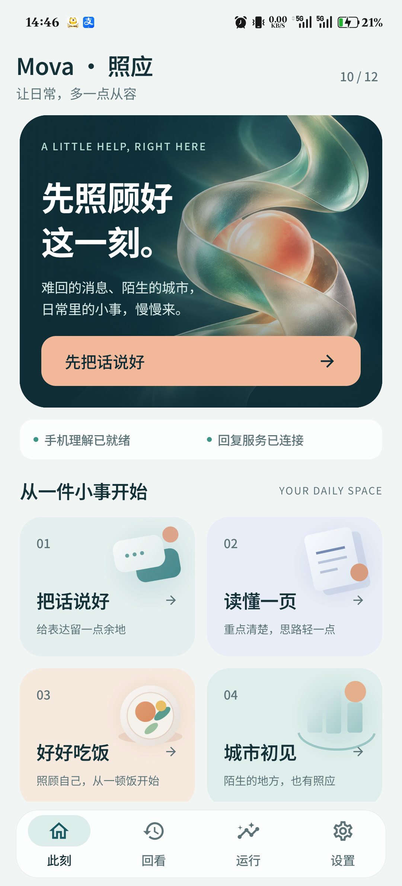
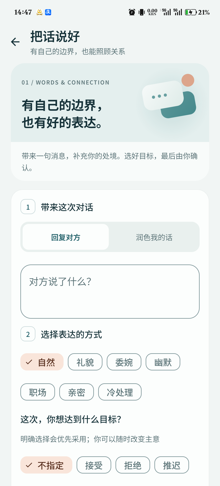
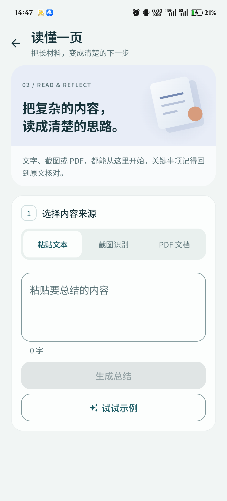
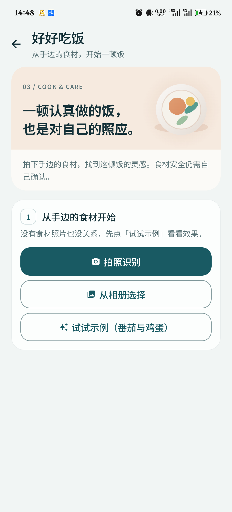
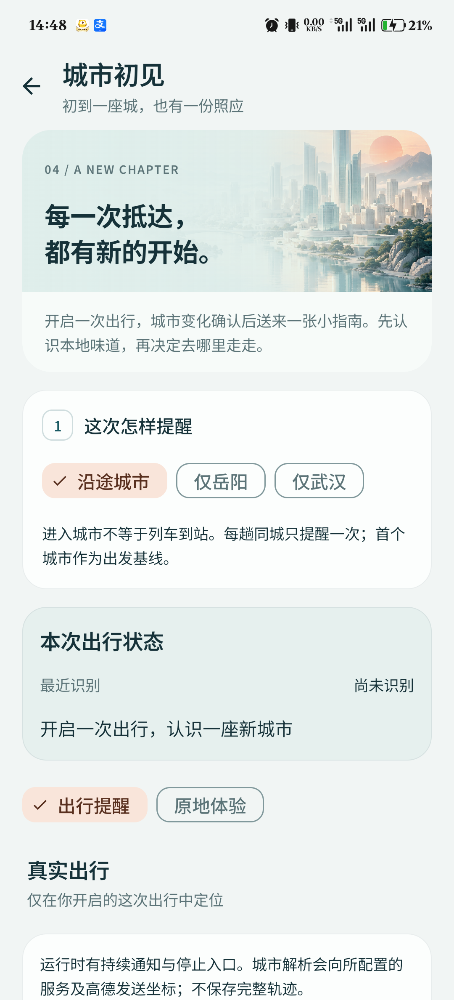
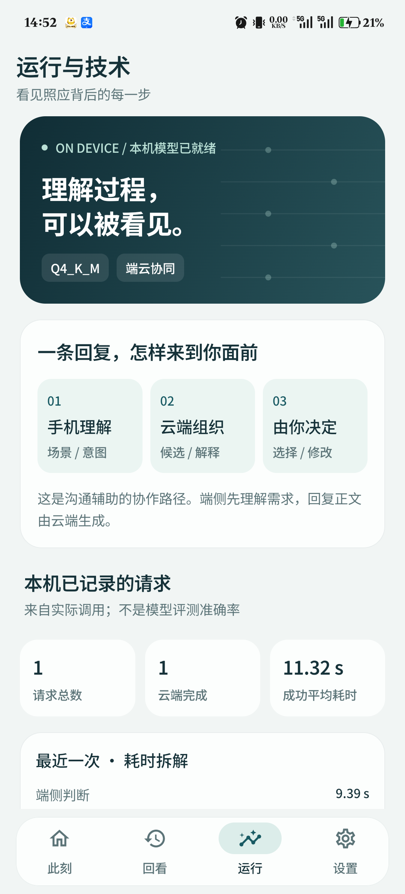

# Mova·照应：竞赛视觉升级

更新：2026-10-12。当前实现以本文件为准，早期 UI 设计文档保留作为历史方案。

## 设计方向

核心仍是「离家之后，小事也有重量」。视觉从暖色大卡片，升级为珍珠白底色、深海青主视觉与少量暖珊瑚强调色。首页给出一个清晰的情绪入口，功能页把氛围和任务步骤分开。

- **首页**：原创玻璃环抱光球承载「先照顾好这一刻」，四个等宽场景卡分别使用气泡、纸页、餐盘与城市装饰。状态条只显示真实模型和服务检测。
- **沟通**：场景头图、回复 / 润色分段入口、消息输入和表达偏好分组；保留多轮上下文、生成、复制和解释。
- **阅读**：纸页装饰与蓝灰色场景背景；文本、截图、PDF 使用等宽分段入口，输入区与操作区位于统一任务卡。
- **做饭**：餐盘装饰与暖砂色背景，突出拍照、相册和示例三个入口。保留真实识别 / 生成链路。
- **城市**：使用抽象抵达氛围图；出行提醒和原地体验分开，手动点位与识别过程可展开。氛围图不是青岛或其他目的地的实景照片，不作为推荐来源。
- **运行**：保留一级导航，页面名称为「运行与技术」。先解释沟通辅助的工作路径，再展示本机实际记录；模型参数、统计口径、本机试运行可展开。

## 为什么保留「运行」

对普通用户，它解释手机模型和云端各自做什么；对评委，它提供可复现的模型试运行与真实调用证据。因此保留是合适的，但不能把调试参数和日志堆成默认首页。

沟通辅助是「端侧理解 → 云端组织正文 → 用户选择」。端侧预判不等于完整回复离线生成。「端侧完成」只有完整用户结果由端侧完成时才计入。请求总量和耗时来自本机保存的调用记录，不是训练评测集上的准确率，也不限定为本次启动会话。

## 字体与资产

中文使用 Noto Sans SC 可变字体，明确选择 400 / 500 / 600 / 700 字重，防止手机主题字体把页面变成不同风格。字体来自 [Google Fonts 的官方字体仓库](https://github.com/google/fonts/tree/main/ofl/notosanssc)，SIL Open Font License 随源码保留在 SceneAi_App/licenses/NotoSansSC-OFL.txt。

两张背景图使用内置 image_gen 生成，未复用参赛作品图片。图片不包含烘焙文字、按钮或实际数据；文字和交互由 Android Compose 渲染。场景装饰为原生 Canvas 绘制，不增加网络请求。

| 文件 | 用途 |
|---|---|
| SceneAi_App/app/src/main/res/drawable-nodpi/mova_hero_v3.png | 首页氛围背景 |
| SceneAi_App/app/src/main/res/drawable-nodpi/mova_city_v3.png | 城市页抽象抵达背景 |
| SceneAi_App/app/src/main/res/font/mova_sans_sc.ttf | 中文无衬线字体 |
| ui/components/SceneVisuals.kt | 场景装饰、场景头图、任务步骤与分段入口 |

背景图随 APK 本地打包；首次打开不依赖图片下载。文字使用真实字体并随系统文字大小布局，装饰不参与读屏顺序；分段入口保留选中语义与 48 dp 高度。夜间使用独立容器色。

用户给定的 [参赛作品展示页](https://www.cmit.cn/html/yidongyingyong/show-157-3828-1.html) 作为展示形式参考。本项目仍使用自己的产品叙事、视觉资产和交互实现。

## 实机截图

以下来自 OPPO Find X7 Ultra 的实际 APK 页面，不是效果图：

| 首页 | 沟通 |
|---|---|
|  |  |

| 阅读 | 做饭 |
|---|---|
|  |  |

| 城市初见 | 运行与技术 |
|---|---|
|  |  |

首页夜间模式见 [深色实机截图](assets/ui-v3/home-dark.png)，实际示例回复见 [沟通结果截图](assets/ui-v3/chat-result.png)。

## 本轮核查

- Android arm64-v8a / x86_64 编译成功，APK 已安装到 OPPO 真机。
- 首页四个入口、沟通 / 阅读 / 做饭 / 城市页面及运行页均已打开并检查截图。
- 沟通「回复 / 润色」切换、阅读 PDF 入口、运行页详情展开已检查。
- 使用 App 自带沟通示例生成一次回复，结果页显示正文与复制入口，运行页记录一次云端完成及实际端侧判断。
- 本次单条示例在界面显示总耗时约 11.32 秒、端侧判断约 9.39 秒；只是一次功能回归，不是平均性能、准确率或跨设备基准。
- 首页深色模式实机检查通过，核查后恢复用户原有的浅色偏好。
- 城市真实跨城、长期后台及其他机型仍沿用既有验收边界，不因视觉升级视为已通过。

## 素材生成提示词

生成方式：内置 image_gen；不是 CLI 或额外付费 API 脚本。原始图片在 Codex 生成目录保留，项目使用上表的本地副本。

### 首页

~~~text
Use case: stylized-concept. Asset type: original full-bleed background illustration for the hero card of an Android app called Mova, a thoughtful daily companion for young adults living independently. Create one premium contemporary editorial 3D artwork, landscape 3:2 composition. A single elegant folded ribbon made of frosted pearl glass and pale mint translucent resin curls around a small luminous warm coral sphere, like a gentle embrace, floating over a deep petrol teal background (#102D35). The sculpture occupies the RIGHT half, with the LEFT 45% quiet dark teal negative space for live UI text; no lettering is present in the image. Left edge and lower edge are smooth dark teal, so white text remains readable. Soft realistic indirect light, carefully crafted glass caustics, subtle fine-grain material, a restrained misty aurora glow behind the sculpture, refined studio art direction. Contemporary creative technology brand, emotionally warm but visually precise, sophisticated and spacious. No phone, no UI, no typography, no logo, no human faces, no flowers, no planets or outer space stars, no sparkles, no busy pattern, no neon cyberpunk, no stock illustration. This is a usable art asset, not an app mockup.
~~~

### 城市

~~~text
Use case: stylized-concept. Asset type: original atmospheric header background for the City First Encounter page of a premium Android daily companion app. Landscape 3:2 artwork, no text or UI. A poetic miniature contemporary Chinese city built from sculpted ivory architectural blocks, slender pale teal glass towers and a single warm coral sun low on the horizon, seen from a train-window-like wide vista, with a graceful river curve leading into the city. Refined editorial 3D render, light matte porcelain, translucent pale cyan glass, nuanced studio daylight and soft shadows. Architecture clustered on RIGHT two-thirds; LEFT one-third quiet misty pale pearl-white negative space for dark teal live UI copy. Top left and left edges softly fade toward #EEF4F3. Distinctively contemporary, sophisticated, youthful, calm, a warm sense of arriving somewhere new, carefully controlled scale and beautiful composition. No actual named landmark, no readable letters, no roads with cars, no phone frame, no navigation UI, no skyline stock photograph, no saturated cartoon rainbow, no ornate decoration, no sparkles, no watermark.
~~~
